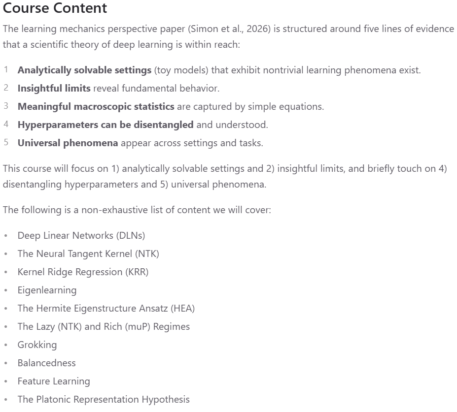

I recently learned that [the first learning mechanics course](https://mrkdh16.github.io/learning-mechanics-decal/) is being offered at UC Berkeley!

The course is being offered as a "DeCal". At UC Berkeley, DeCal stands for "Democratic Education at Cal". It's a program that gives undergraduate students the opportunity to lead courses on topics they find interesting. The classes are typically pass/fail, allowing students to explore their interests without worrying about grades.

The course is organized by [Mark Rhee](https://mrkdh16.github.io/), an undergrad at UC Berkeley who studies math, computer science, and physics. The faculty sponsor is [Michael DeWeese](https://physics.berkeley.edu/people/faculty/michael-deweese), whose research interests are in nonequilibrium statistical mechanics, machine learning theory, and systems neuroscience. 

Also exciting is that the course is listed as a *physics* course---Physics 198: (Deep) Learning Mechanics.

Here's how the course is described on the course website:

> Deep learning is in a peculiar situation at this moment in time. Empirically, the capabilities of AI leveraging deep learning (eg. LLMs) have surpassed the expectations of even the most radically optimistic researchers. ... Yet, we lack a comprehensive scientific framework for understanding how exactly these models work and the development of frontier models is closer to alchemy than science.
>
> Not long ago, engineers built working steam engines before anyone understood the science behind them. ... Deep learning may be our generation's steam engine. Learning mechanics is the emerging discipline that aims to understand it from first principles, treating deep learning the way physics treats the natural world: seeking compact mathematical principles, tight connections between theory and experiment, and simple, intuitive explanations for complex phenomena.

The course syllabus borrows heavily from the paper ["There Will Be a Scientific Theory of Deep Learning"](https://arxiv.org/abs/2604.21691) which [I covered on this blog earlier this year]().

Impressively, Rhee appears to be compiling bespoke lecture notes for the course. The first three chapters are already up on the website:

- [Chapter 1: Introduction to Neural Networks](https://mrkdh16.github.io/learning-mechanics-decal/lecture-notes/ch1.pdf)
- [Chapter 2: Toy Model I: Deep Linear Networks](https://mrkdh16.github.io/learning-mechanics-decal/lecture-notes/ch2.pdf)
- [Chapter 3: Toy Model II: Kernel Regression](https://mrkdh16.github.io/learning-mechanics-decal/lecture-notes/ch3.pdf)

It's exciting to see learning mechanics continue to grow!
