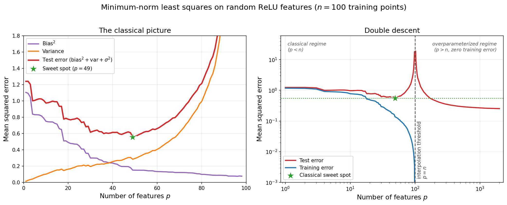

**1:** [Andrew Gordon Wilson on generalization in deep learning](https://arxiv.org/abs/2503.02113).

Given a model---a range of admissible hypotheses or functions---and an associated fitting procedure, there are broadly two sources of generalization error. There is *bias*, the error that arises when your average fitted function differs from the true function. And there is *variance*, the error that arises from randomness in the fitted function caused by different training data, initialization, and so on. 

The expressivity of a model is the range of functions it can represent. In classical statistics, [we have the bias-variance tradeoff](). A model with low expressivity has low variance but high bias, while a model with high expressivity has high variance but low bias. This tradeoff produces the classic U-shaped curve of generalization error as a function of expressivity. 

However, neural networks contradict this received wisdom. Although they are often heavily overparameterized, they still generalize well. And phenomena such as [double descent](https://en.wikipedia.org/wiki/Double_descent) suggest that the more overparameterized they are, the *better* they generalize!

While this is often presented as one of the central mysteries of deep learning, Wilson makes the point that it isn't really *so* mysterious. Even in classical statistics, we already know that highly overparameterized models can generalize well when properly regularized. We then have that neural networks induce a regularization that favors solutions that generalize.

He also does a good job of highlighting that a lot of the conceptual confusion arises because people often think about inductive biases as "restriction biases"---where you limit your allowed functions to the more useful ones. If you think in terms of restriction biases, it's confusing why larger neural networks would have better generalization properties, as they are obviously more expressive than smaller networks, being able to encode a larger set of functions. But with the idea of *soft inductive biases*, the mystery dissolves itself: even though larger neural networks can encode more functions, if they systematically allocate measure towards better-generalizing solutions (e.g., a preference for solutions with lower [Kolmogorov complexity](https://en.wikipedia.org/wiki/Kolmogorov_complexity)/description length), then the extra expressivity doesn't have to hurt generalization---a bigger model can be both more expressive *and* more strongly biased towards simple solutions. [There is a video of him talking about related ideas](https://youtu.be/lKoJJxjUfdw).

**2:** [Beren Millidge on algorithmic progress](https://www.beren.io/2026-09-16-Algorithmic-Progress-is-not-Exogenous/).

Millidge argues that algorithmic progress isn't purely exogenous: researchers, funding, talent, and compute all reinforce one another through a positive feedback loop. For example, if a machine learning researcher makes a major breakthrough, such as a new architecture, more money flows into the ecosystem. Labs then spend that money on compute which causes cloud companies---anticipating future demand---to build out more infrastructure. It's yet another great example of a tried-and-true piece of wisdom: first-order effects are generally bigger than second-order effects. If you put resources and talent into AI capabilities, then your expectation should be that timelines have just been pulled forward.

It also matches my experience doing research: insights have a way of compounding on each other, even if they aren't logically connected per se. Oftentimes during research, I will have a longstanding misconception that only gets corrected when I am essentially forced to do so by undeniable empirical data. In hindsight, I will realize that I could have cleared up the misconception without the empirical data by some obvious line of reasoning---but somehow it rarely works out that way. Once you find a plausible explanation for something, you tend to stop considering the full range of alternative hypotheses.

**3:** [Terry Tao's AI-maintained website](https://teorth.github.io/tao-web/).

Terry Tao is a famous mathematician at UCLA, known for his early achievements at the International Mathematical Olympiad and for being a Fields Medalist. He's also a busy guy, so apparently he has a website maintained *with AI assistance* where he compiles his papers, talks, and various views on mathematics and AI. 

It makes sense: Tao's output is unusually prolific even for a well-respected mathematician. In addition to traditional output like research papers and textbooks, he also [blogs regularly](https://terrytao.wordpress.com/). He also gives a lot of talks and interviews, many of which can be found on YouTube. These range across the entirety of the sophistication spectrum: from advice for people just getting into math to talks so technical that they are really only meant for a dozen other people in the world.

He has also been following AI closely. My impression was that he has been involved in formalizing proofs via Lean for a while now, but for the past few years he has also been giving [updates on his evolving views on LLMs and mathematics](https://teorth.github.io/tao-web/ai-views.html).

**4:** [AI In Context](https://www.youtube.com/@AI_In_Context).

AI In Context is a newish YouTube channel about the risks from advanced AI. Despite being a new channel, it came out of the gate with extremely high production value and tight scripting---which makes sense, as it's an [80,000 Hours](https://80000hours.org/) project. In this video, they talk about [*If Anyone Builds It, Everyone Dies*](https://ifanyonebuildsit.com/)---Eliezer Yudkowsky and Nate Soares's book arguing that superintelligent AI built with anything like current techniques would lead to human extinction.

    <iframe
        style="position: absolute; top: 0; left: 0; width: 100%; height: 100%;"
        src="https://www.youtube.com/embed/Nl7-bRFSZBs"
        title="YouTube video player"
        frameborder="0"
        allow="accelerometer; autoplay; clipboard-write; encrypted-media; gyroscope; picture-in-picture; web-share"
        allowfullscreen>
    </iframe>

**5:** [Mike Winer on going from academia to alignment](https://millicosm.substack.com/p/from-academia-to-alignment).

Mike Winer talks about his experience transitioning from physics research at the Institute for Advanced Study (IAS) to alignment research at ARC. It's less about the technical details of the transition and more about the personal journey.

Physics tends to be a totalizing. It seems to be the norm that physicists don't just regard it as a job or even a career, but as a type of *identity*. Part of it might be the long investment costs. A large fraction of aspiring physicists first get the dream in high school. Even for those who are talented, it usually takes until midway through their PhD for them to really start contributing. So you are looking at almost a decade of intense study of wide-ranging, mathematically difficult subject material before you can attain your dream.

Understandably, when someone has to leave physics to work on something else, that can cause a lot of psychological pain---and Mike seems to have been no exception. In his case, he had to give up daily lunches with Juan Maldacena.

You should subscribe to [Mike's Substack](https://millicosm.substack.com/)! And while I'm on the topic: [go apply to work for ARC](https://www.alignment.org/hiring/)!
