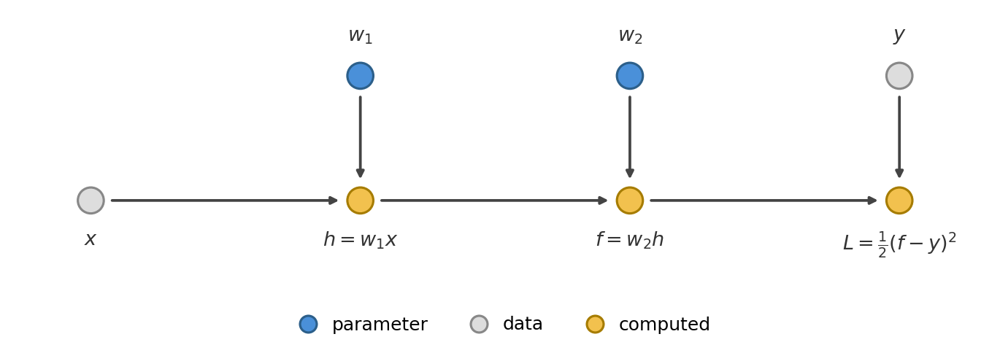
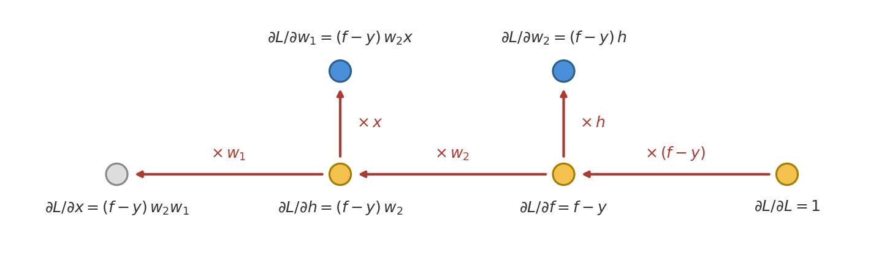
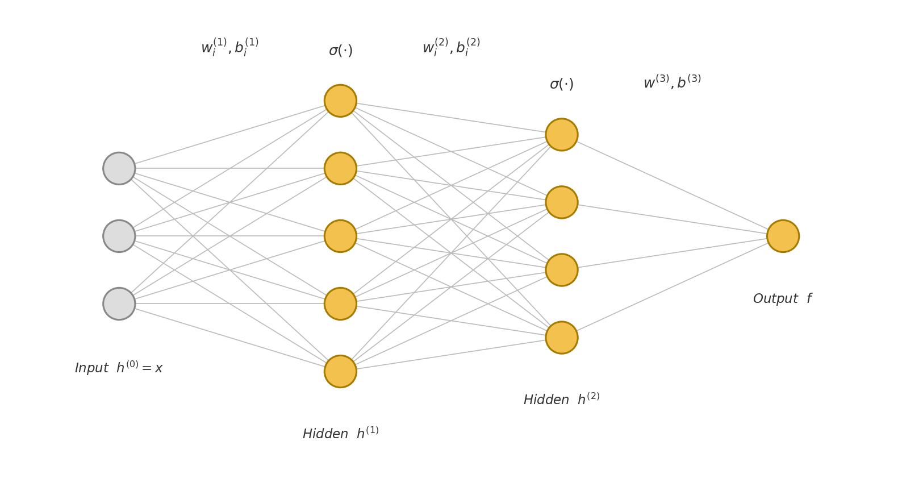
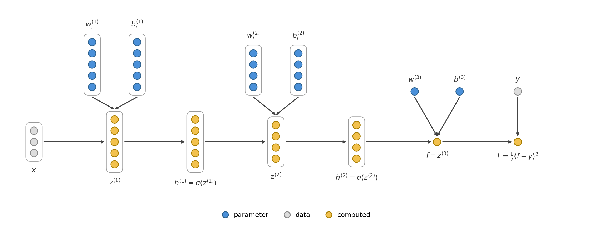

To train a neural network, you have to construct a *loss function*---a function that has a large value when the network performs the desired task poorly and a small value when it performs well. Once you have the loss function, you can improve the network's performance by minimizing the loss.

But how do you minimize the loss function in practice? One approach you can try is guess-and-check: generate random values for the parameters and compute the resulting loss. If the loss is too large, you discard those parameters. You can then keep randomly re-sampling parameters until you happen to find a model with a sufficiently small loss.

While this method might work for easy tasks, it fails for sufficiently complex tasks. For example, if you want a model that can write coherent paragraphs of text, only a vanishingly small region of parameter space achieves that level of performance---so random guessing will essentially never find a viable solution.

A better approach is to minimize the loss incrementally via *gradient descent*. If you imagine the loss function as a landscape of mountains and valleys, the gradient of the loss is a vector that points uphill---in the direction of steepest ascent. You can then decrease the loss by taking small, controlled steps *downhill* from your current location. While each step decreases the loss only slightly, if you iterate this process enough times, those small improvements can add up to an extremely capable model.

Of course, in order to implement gradient descent, we need some way of computing the gradient. But it's not obvious that we can compute the gradient of the loss function in a computationally efficient way. The gradient is the vector of partial derivatives of the loss---one component per parameter. The way partial derivatives are defined, the component of the gradient for parameter $\theta_i$ measures how the loss changes when you nudge that parameter *while keeping all other parameters constant*:

$$\frac{\partial L}{\partial \theta_i} = \lim_{\epsilon \to 0} \frac{L(\theta_1, \ldots, \theta_i + \epsilon, \ldots, \theta_p) - L(\theta_1, \ldots, \theta_i, \ldots, \theta_p)}{\epsilon}.$$

So one way to compute the gradient of the loss function would be to compute this difference quotient for each parameter using a sufficiently small $\epsilon$. But that wouldn't be computationally feasible. To evaluate the loss at a displaced parameter value, we have to run the network on the data from input to output (which is called the *forward pass*). Computing the gradient this way would then require a forward pass of the model for *every* parameter (plus one baseline evaluation at the unperturbed parameters). If the model has $p$ parameters, that is $p + 1$ forward passes in total. For a modern network---where $p$ runs into the billions or even trillions---that's prohibitively expensive.

# The Forward Pass and The Backward Pass

To compute the gradient efficiently, we will need to use the structure of the network to our advantage. Thankfully, while we often describe neural networks as black boxes, that description isn't literally true. We have access to the architecture, so we know precisely how the network computes its function.

A neural network can be viewed as a *computational graph*: a composition of simple functions, where each node takes the outputs of earlier nodes as its inputs. Conveniently, we know how to take derivatives of compositions of functions. Given functions $g$ and $u$, the derivative of their composition is given by the chain rule:

$$\frac{d}{dx} g(u(x)) = g'(u(x))\, u'(x)$$

Recall that the derivative gives the best linear approximation of a function at a point. The linear approximation of a composition of functions is then the composition of their linear approximations. For 1-D functions, the composition of two linear functions is a linear function whose slope is the product of their slopes.

How is this relevant to neural networks? For a simple example, take a one-dimensional *diagonal linear network*:

$$f(x; w_1, w_2) = w_2 w_1 x.$$

The network computes $f$ in two steps. First, it multiplies the input by the first weight to get $h = w_1 x$. Intermediate values like $h$, which the network computes on the way to the output, are called *activations*. Second, it multiplies this activation by the second weight to get the output, $f = w_2 h$. 

For the loss, we'll use the squared error on a single training example $(x, y)$, where $y$ is the target output:

$$L = \frac{1}{2}(f - y)^2.$$

We can represent the computation of the loss as computational graph:

In this graph, each arrow points from an input to the node that takes it as an argument. And below each computed node is the function that produces the value of the node from its inputs. Notice that the computational graph of the diagonal linear network includes not only the chain $x \to h \to f$ but *also* the parameters---each one represented by a node. This might seem odd, since in neural networks we usually treat inputs and parameters as different things. However, within a single forward pass, they play the same role: inputs and parameters are both arguments passed to the network to compute its output.

How do we use the computational graph to compute the derivatives of the loss with respect to the parameters? 

To build intuition, it helps to start with the derivatives of the loss with respect to a couple of the other nodes. We call these derivatives *sensitivities*. The sensitivity of a node measures how much the loss changes per unit perturbation of that node's value, holding fixed every quantity upstream of the node or parallel to it. Note that for nodes corresponding to parameters, the sensitivity coincides with the partial derivative that keeps the other parameters fixed, since in our computational graph all the parameters are parallel to each other.

Trivially, we have that $\frac{\partial L}{\partial L} = 1$, since increasing the loss by one unit increases the loss by one unit. For $\frac{\partial L}{\partial f}$, we have

$$\frac{\partial L}{\partial f} = f - y.$$

So we can compute the sensitivity of $f$ as long as we have $f$ and $y$. 

The target $y$ is part of the training example---which we already have. To get $f$, we can run a forward pass of the network and store the value of $f$ it produces.

Now consider the sensitivities of the activation $h$ and the parameter $w_2$. Recall that $f$ is a function of $w_2$ and $h$, so we can express the loss as a function of $h$, $w_2$, and $y$. By the chain rule, the sensitivities are

$$ 
\begin{align}
\frac{\partial L}{\partial h} &= \frac{\partial L}{\partial f} \frac{\partial f}{\partial h} \\
\frac{\partial L}{\partial w_2} &= \frac{\partial L}{\partial f} \frac{\partial f}{\partial w_2}
\end{align}
$$

So if we already know the sensitivity of $f$, we only need the partial derivatives of $f$ with respect to its immediate arguments, $h$ and $w_2$, to compute their sensitivities. 

But aren't we back where we started? Recall that our original difficulty was that computing the gradient of the loss naively requires many computationally expensive finite differences. At first glance, it seems we haven't solved this problem, since we still need to compute derivatives of these internal nodes.

The difference is that, while the loss is a complicated function of any given parameter, the function each node in the computational graph computes from its local arguments is known and simple. We already saw that the loss as a function of $f$ and $y$ is simply a quadratic, so its derivative is linear. Similarly, we know that $f = w_2 h$, the product of $w_2$ and $h$. So there is no need for finite difference approximations of the derivatives of internal nodes, since they have easy-to-find, exact answers. And once we have those derivatives, the chain rule gives us the sensitivities:

$$ 
\begin{align}
\frac{\partial L}{\partial h} &= \frac{\partial L}{\partial f} w_2 \\
\frac{\partial L}{\partial w_2} &= \frac{\partial L}{\partial f} h
\end{align}
$$

Notice that the sensitivity of $w_2$ depends on $h$. In general, we will find that the sensitivities of the parameters depend on the network's activations. So during the forward pass, it's convenient to store *every* quantity computed along the computational graph, not just the output. This can use a lot of memory, but it means we only need to run the forward pass once to compute all the sensitivities.

Importantly, this process can be carried out iteratively for arbitrarily complicated computational graphs. You start at the output and compute its sensitivity. Then you work backward through the network, using the chain rule to compute each node's sensitivity from the sensitivities of the nodes it feeds into. This process of chaining backward to compute sensitivities is called the *backward pass*.

# Backprop on the MLP

Let's briefly walk through how backpropagation works on a *multi-layer perceptron* (MLP). An MLP is a neural network architecture organized into layers, where each layer's activations are computed from the activations of the previous layer. 

Each neuron in a layer takes the dot product of its weight vector with the activations of the previous layer and adds a bias. The result is called the neuron's *pre-activation*. The neuron then passes the pre-activation through a nonlinear function $\sigma$, called the *activation function*, which gives the neuron's activation. Writing $z$ for pre-activations and $h$ for activations, neuron $i$ in layer $\ell$ computes

$$
\begin{align}
z_i^{(\ell)} &= w_i^{(\ell)} \cdot h^{(\ell-1)} + b_i^{(\ell)} \\
h_i^{(\ell)} &= \sigma(z_i^{(\ell)})
\end{align}
$$

where $w_i^{(\ell)}$ and $b_i^{(\ell)}$ are the neuron's weight vector and bias and $h^{(\ell-1)}$ is the vector of the previous layer's activations. By convention, we have that $h^{(0)} = x$. 

Let $N$ denote the number of layers. The last layer has a single neuron and no activation function, so its pre-activation is the output:

$$f = w^{(N)} \cdot h^{(N-1)} + b^{(N)}.$$

An important difference between the MLP and the diagonal network is that each activation now feeds into *every* neuron in the next layer, rather than into a single node. So when we chain backward, an activation's sensitivity is a sum over all the neurons it feeds into.

Let's compute some sensitivities. Starting from the output, its sensitivity is still $\partial L / \partial f = f - y$. The sensitivity of the last layer's weights is then the vector of penultimate-layer activations scaled by the sensitivity of $f$. Symmetrically, the sensitivity of the penultimate-layer activations is the last layer's weight vector scaled by the same factor:

$$
\begin{align}
\frac{\partial L}{\partial w^{(N)}} &= \frac{\partial L}{\partial f}\, h^{(N-1)} \\
\frac{\partial L}{\partial h^{(N-1)}} &= \frac{\partial L}{\partial f}\, w^{(N)}
\end{align}
$$

This mirrors what we found for the diagonal network, except that the weights and activations are now vectors rather than scalars.

Each penultimate-layer activation is computed from its pre-activation by the activation function, so the sensitivity of the pre-activation $z_i^{(N-1)}$ is the sensitivity of its activation multiplied by the derivative of the activation function, $\sigma'(z_i^{(N-1)})$. Since the bias enters the pre-activation additively, the derivative of the pre-activation with respect to the bias is just 1, so the bias has the same sensitivity as the pre-activation.

We can apply the same steps apply at every layer. For layer $\ell$, the sensitivities of the activations, pre-activations, biases, and weight vectors are

$$
\begin{align}
\frac{\partial L}{\partial h^{(\ell)}} &= \sum_i \frac{\partial L}{\partial z_i^{(\ell+1)}}\, w_i^{(\ell+1)} \\
\frac{\partial L}{\partial z_i^{(\ell)}} &= \sigma'(z_i^{(\ell)})\, \frac{\partial L}{\partial h_i^{(\ell)}} \\
\frac{\partial L}{\partial b_i^{(\ell)}} &= \frac{\partial L}{\partial z_i^{(\ell)}} \\
\frac{\partial L}{\partial w_i^{(\ell)}} &= \frac{\partial L}{\partial z_i^{(\ell)}}\, h^{(\ell-1)}
\end{align}
$$

The backward pass is just these four equations applied one layer at a time, starting from the output and working back to the first layer.

